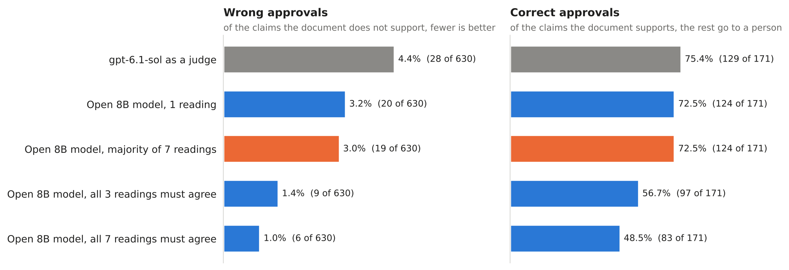

# LLM Verification with a Controllable Error Rate



A claim is approved only when it follows from the document under every reading the model proposes. Asking for more
readings to agree cuts wrong approvals from 28 to 6 out of 630, and sends more cases to a person. Taking the majority
reading does not cut them. 801 stories from FOLIO and two variants of it; the numbers come from `notebooks/06_results.ipynb`.

Code and data for the paper *LLM Verification with a Controllable Error Rate* (Javier Marín, 2026).

## What the paper is about

Some systems check a claim against a document by translating both into logic and letting an exact solver decide
whether the claim follows. The solver does not make mistakes, but the translation can: a sentence can be read in more
than one way, and the translator can miss what the author meant. When that happens, the system may approve a claim the
document does not support.

The paper gives an organization three things it needs before it relies on such a system:

1. **How often it approves something it should not**, on the organization's own documents. A wrong approval can only
   happen when the translator has lost the right reading of some sentence, so checking a sample of the approved cases
   by hand bounds the rate.
2. **A setting that trades wrong approvals for human review**, in a direction known in advance. The system approves a
   claim only if it follows under every candidate translation. More candidates mean fewer wrong approvals and more
   cases sent to a person.
3. **Errors that can be traced.** Every wrong approval points to the sentence whose reading was lost.

The experiments use an open model of eight billion parameters, running locally, on FOLIO and two variants of it, and
compare it with two frontier models used as judges.

## Reproduce the results

Every table and figure of the paper comes out of `notebooks/06_results.ipynb`, which runs on a laptop in about five
minutes from the stored readings and judge answers.

```bash
git clone https://github.com/groundlens-dev/research
cd research
pip install -e ".[notebooks]"
jupyter lab notebooks/06_results.ipynb
```

The other notebooks rebuild what the results notebook reads. Each one compares what it builds with the stored files.

| Notebook | What it does | Needs |
|---|---|---|
| `01_test_sets` | Builds the three test sets from FOLIO | CPU, under a minute |
| `02_training_data` | Builds the training data of the three translators | CPU, about 40 minutes |
| `03_translators` | Fine-tunes translators v2, v3 and v4 with QLoRA | GPU with 24 GB, about an hour each |
| `04_readings` | Generates the readings of every story, and the controls outside FOLIO | GPU with 24 GB |
| `05_judges` | Asks `gpt-6.1-sol` and `claude-opus-5-5` for a verdict on every story | API keys |
| `06_results` | Every table and figure of the paper | CPU, about five minutes |

The test sets and the training data rebuild byte for byte. Readings and judge answers do not: sampling on a GPU and
hosted models change with hardware, library versions and time, which is why the paper's own readings and answers are
stored here.

## What is in the repository

```
src/logicverifier/
    logic.py        formulas, Z3, and the decision over sets of readings (Definition 1)
    prompts.py      every prompt and decoding grammar of Appendix A
    data.py         test sets, DGT and ContractNLI preparation, training mixtures
    synthetic.py    stories whose labels are correct by construction
    models.py       QLoRA training, generation with vLLM, controls, hosted judges
    analysis.py     decision rules, measures, statistical tests, the estimate of the error rate
notebooks/          the six notebooks above
data/               what cannot be downloaded elsewhere (below)
figures/            the figure of the paper, written by notebook 6
tests/              quick checks of the logic and of the reproduction
```

`data/`:

| Folder | Contents |
|---|---|
| `test_sets/` | FOLIO original (179 stories), with new names (179) and counterfactual (443) |
| `readings/v2`, `v3`, `v4` | Seven readings of every story by each translator |
| `judges/` | Raw answers of `gpt-6.1-sol` (801 stories) and `claude-opus-5-5` (279 stories) |
| `training/` | DGT sentences, common-sense questions, synthetic stories, ContractNLI cases and their verified translations, vocabulary groups and stories, and the v2 mixture |
| `controls/` | Results of the controls outside FOLIO (Appendix C) |
| `before_vocabulary_fix/` | Test sets and readings of v2 and v3 before the vocabulary extraction was corrected (Appendix C) |

Not included, because they can be downloaded: the base model
[`mistralai/Ministral-3-8B-Base-2512`](https://huggingface.co/mistralai/Ministral-3-8B-Base-2512), FOLIO (read at a
fixed commit by `data.download_folio`), ContractNLI and the DGT translation memory. The trained adapters (about
170 MB each) are available on request.

The error analysis of Appendix D was done by hand and has no notebook.

## Using the verifier on your own stories

```python
from logicverifier.logic import decide_reading_sets

premise_readings = [
    ["∀x (Supplier(x) → ¬PaysVat(x))", "∀x (Supplier(x) → PaysVat(x))"],   # two readings of "No supplier pays VAT."
    ["Supplier(acme)"],
]
claim_readings = ["PaysVat(acme)"]
decide_reading_sets(premise_readings, claim_readings)   # "Uncertain": the readings disagree, so the case goes to review
```

## Licences

The code is released under the Apache 2.0 licence. The data keeps the licence of its source:

| Data | Source | Licence |
|---|---|---|
| Test sets, FOLIO examples in the mixtures | [FOLIO](https://github.com/Yale-LILY/FOLIO) | CC BY-SA 4.0 |
| ContractNLI cases and their translations | [ContractNLI](https://stanfordnlp.github.io/contract-nli/) | CC BY 4.0 |
| DGT sentences | [DGT translation memory](https://joint-research-centre.ec.europa.eu/language-technology-resources/dgt-translation-memory_en), via OPUS | reuse with acknowledgement, © European Union |
| Vocabulary groups and stories | EuroVoc (© European Union), [FIBO](https://github.com/edmcouncil/fibo) (MIT), [DPV](https://github.com/w3c/dpv) (W3C) | as their sources |
| Common-sense questions | [Wikidata](https://www.wikidata.org) | CC0 |
| Synthetic stories, readings, judge answers | this work | CC BY 4.0 |

## Citation

```bibtex
@misc{marin2026controllable,
  title  = {LLM Verification with a Controllable Error Rate},
  author = {Mar{\'i}n, Javier},
  year   = {2026},
  note   = {Code and data: https://github.com/groundlens-dev/research}
}
```

Copyright 2026 Javier Marín.
